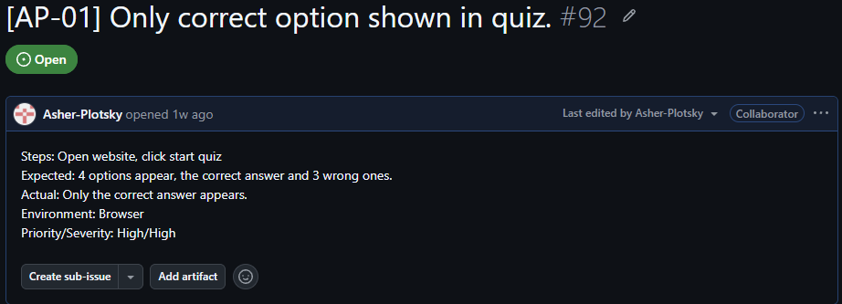
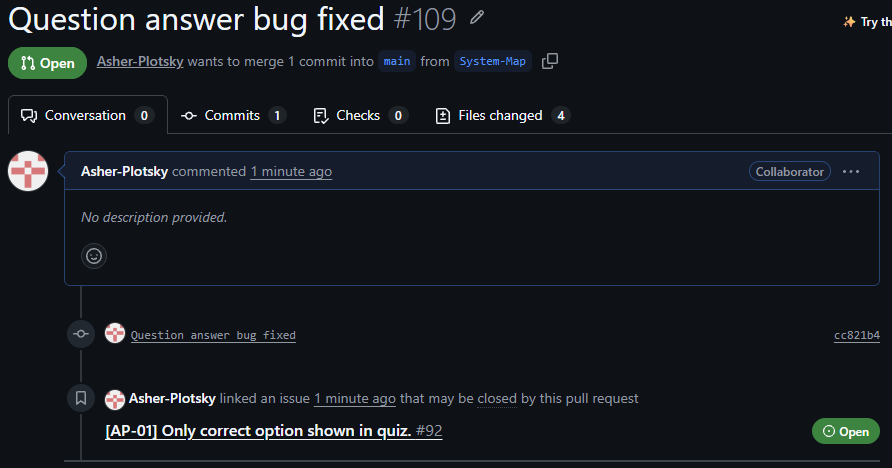
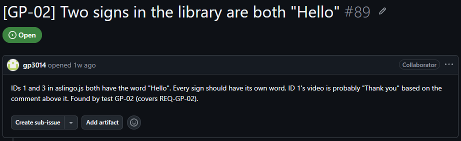
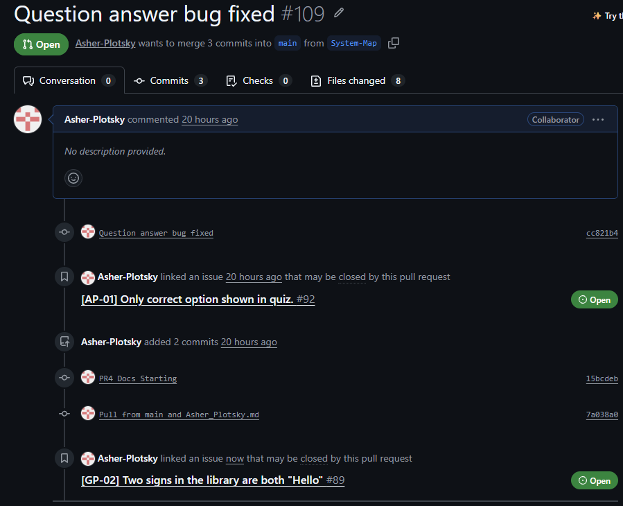

https://github.com/Sunnuke/CS250-PR1/issues/92

https://github.com/Sunnuke/CS250-PR1/pull/109

This was a code bug, the buttons themselves did not appear properly while running the app, the test itself did not reveal the issue it was just always there.

---

https://github.com/Sunnuke/CS250-PR1/issues/89

https://github.com/Sunnuke/CS250-PR1/pull/109

This was a code bug, they were labeled incorrectly inside of the code.