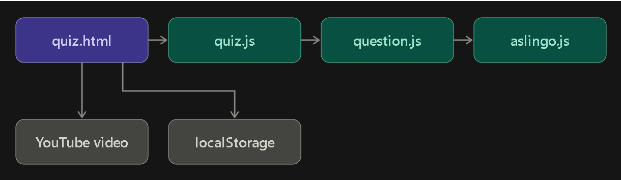

1: Purpose  ->  Asher Plotsky
This is a website to teach ASL (American Sign Language) through quizzes and videos. While the readMe states that it also wants to teach through lessons it has not been implemented yet.

2: 
Only a frontend no backend given

3: Trace Table → Asher, Debora, Grant
Take quiz    
| Step | Layer | File and Function | Data In/Out |
| :--- | :--- | :--- | :--- |
| 1 | Presentation layer | HTML/index.html → start quiz → button/link |   Input: user clicks button Output:  opens quiz.html |
| 2 | applications/data layer | quiz.html → quiz.js quiz.html → aslingo.js | input : Quiz ID and number of questions. Output: ASL question →  youtube vid → correct/incorrecr answer will be displayed to the user. |

4: Reality Check → Debora Velazquez
What language/framework was used to develop the app?
What is the purpose of the app?
How does it work?

5: 
| ID | Candidate Requirement | Type | Source | Status | Acceptance Critereon |
| :--- | :--- | :--- | :--- | :--- | :--- |
| CR-1 | The system shall display four options when the user takes a quiz | functional | question.js | Suspected bug | Shows four options to a question |
| CR-2 | The system shall show previous quiz answers upon clicking the quiz history button | functional | quizHistory.js | suspected bug | Clicking on button opens up prevous answers page |
| CR-3 | The system shall ask the user 5 questions during the quiz | functional | quiz.js | confirmed | The quiz asks 5 questions |
| CR-4 | The system shall display a video with each question | functional | aslingo.js | confirmed | Each question has a video |
| CR-5 | The system shall randomize the order of questions | functional | quiz.js | confirmed | Each time the quiz is ran, the order of questions is different |

6:
| ID | Requirement | Kind | Input | Expected output | Predicted result today |
| :--- | :--- | :--- | :--- | :--- | :--- |
| TC-1 | CR-2 | Integration | Complete a test, click quiz history button | It shows the output from your quiz attempt | It does not show the output |
| TC-2 | CR-1 | Unit | Click start quiz button | The correct answer and 3 incorrect ones will be shown | Only the correct answer is shown |
| TC-3 | CR-5 | Unit | Click start quiz button and go through the quiz multiple times | The quiz will be different every time | The quiz is different every time |

| Part | Who contributed |
| :--- | :--- |
| 1 | Asher Plotsky |
| 2 | Grant Phillips |
| 3 | Asher, Grant, Debora |
| 4 | Debora Velazquez |
| 5 | Asher Plotsky |
| 6 | Asher Plotsky |