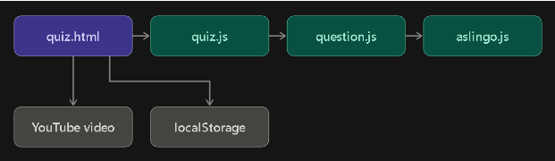

1: Purpose  ->  Asher Plotsky
This is a website to teach ASL (American Sign Language) through quizzes and videos. While the readMe states that it also wants to teach through lessons it has not been implemented yet.

2: 
Only a frontend no backend given

3: Trace Table → Asher, Debora, Grant
Take quiz    
| Step | Layer | File and Function | Data In/Out |
| :--- | :--- | :--- | :--- |
| 1 | Presentation layer | HTML/index.html → start quiz → button/link |   Input: user clicks button Output:  opens quiz.html |
| 2 | applications/data layer | quiz.html → quiz.js quiz.html → aslingo.js | input : Quiz ID and number of questions. Output: ASL question →  youtube vid → correct/incorrecr answer will be displayed to the user. |

4: Reality Check → Debora Velazquez
What language/framework was used to develop the app?
What is the purpose of the app?
How does it work?

| Part | Who contributed |
| :--- | :--- |
| 1 | Asher Plotsky |
| 2 | Grant Phillips |
| 3 | Asher, Grant, Debora |
| 4 | Debora Velazquez |
| 5 | |
| 6 | |